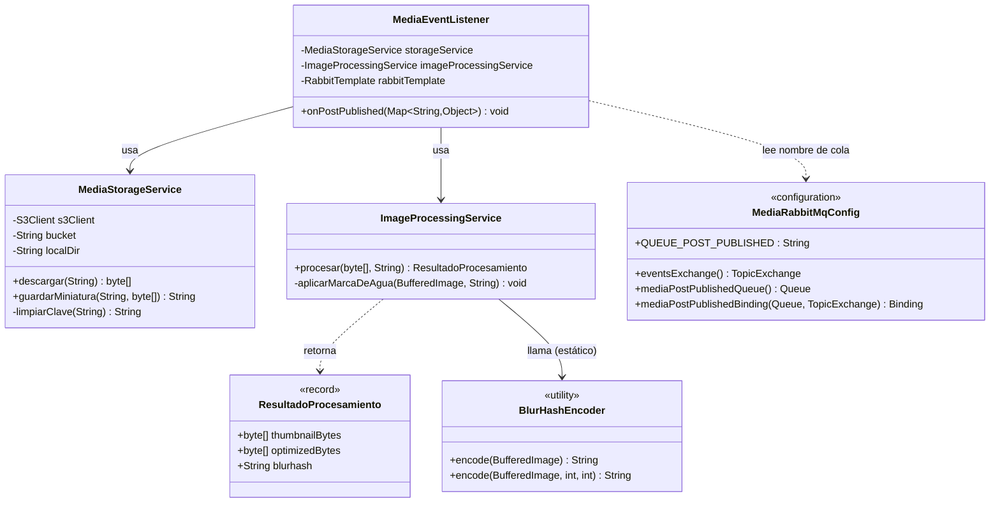
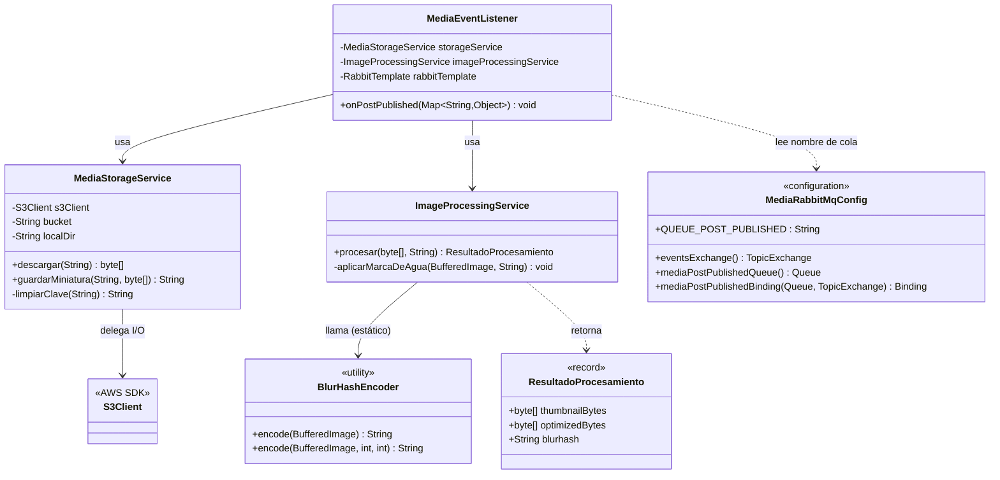

# artagram-media-worker

Worker asíncrono para el procesamiento de medios (imágenes) en ArtaGram.

## Descripción del servicio

`artagram-media-worker` es un worker asíncrono, sin superficie HTTP de negocio (solo expone `actuator` para salud y métricas), que escucha el evento `post.published` en RabbitMQ (exchange `artagram.events`, cola `media.post.published`) y se encarga de todo el pipeline pesado de imagen: descargar el archivo original desde S3/MinIO, generar una miniatura de 400x400 px, calcular su `BlurHash`, generar una versión optimizada de 1200x1200 px con marca de agua, subir el resultado y publicar el evento `media.processed` para que `artagram-feed` actualice la publicación. Existe como worker separado — y no como código síncrono dentro de `feed` o `users` en el momento de subir la imagen — porque decodificar, redimensionar y re-codificar imágenes es un trabajo intensivo en CPU/memoria y de duración variable (depende del tamaño del archivo subido): acoplarlo al request HTTP de publicación obligaría al usuario a esperar ese procesamiento para recibir una respuesta, y haría que la latencia y la capacidad de escalado de `feed`/`users` dependieran de una carga de trabajo completamente distinta (CPU-bound) a la suya (I/O-bound). Al desacoplarlo vía cola, la publicación del post se confirma de inmediato y el procesamiento de la imagen ocurre en segundo plano, con su propio ciclo de escalado independiente basado en profundidad de cola.

## Responsabilidades

- Escuchar el evento `post.published` desde la cola `media.post.published` (bindeada al exchange `artagram.events` con routing key `post.published`) vía `@RabbitListener` en `MediaEventListener`.
- Descargar la imagen original desde S3/MinIO a partir de la ruta/URL recibida en el evento, con fallback a disco local si S3 no está disponible (`MediaStorageService.descargar`).
- Generar una miniatura de 400x400 px en JPEG usando la librería Thumbnailator (`ImageProcessingService.procesar`).
- Calcular el `BlurHash` de la miniatura con una implementación propia en Java puro (`BlurHashEncoder`), sin dependencias externas.
- Generar una versión optimizada de 1200x1200 px con marca de agua (`"ArtaGram • @autor"`) dibujada con Java2D (`Graphics2D`/`AlphaComposite`).
- Subir la miniatura resultante a S3/MinIO, con el mismo fallback a disco local si la subida a S3 falla (`MediaStorageService.guardarMiniatura`).
- Publicar el evento `media.processed` (con `blurhash` y `miniaturaUrl`) en el exchange `artagram.events` para que `artagram-feed` actualice la publicación.
- Resolver las credenciales de AWS de forma condicional en `MediaStorageService`: usa `StaticCredentialsProvider` si se configuran `access-key`/`secret-key` explícitos (caso local con MinIO), o `DefaultCredentialsProvider` si no se configuran — lo que en un entorno real de AWS/ECS resuelve automáticamente las credenciales del **IAM Task Role** de la tarea, sin necesidad de claves estáticas.

## Funcionalidades
- Escucha eventos `post.published` desde RabbitMQ (`artagram.events`).
- Descarga la imagen desde S3/MinIO.
- Genera miniatura de 400x400 px con Thumbnailator.
- Calcula el hash visual BlurHash (algoritmo puro Java).
- Genera versión optimizada de 1200x1200 px con marca de agua artística (`ArtaGram • @autor`).
- Publica evento `media.processed` para que `artagram-feed` actualice la publicación.

## Diagrama de clases

## Atributos de calidad

### Escalabilidad (elasticidad por profundidad de cola)

Este es uno de los dos servicios de ArtaGram que autoescala según mensajes pendientes en RabbitMQ en lugar de CPU/HTTP, al ser un worker 100% *pull-based* sin tráfico entrante que medir por latencia.

- **Fuente:** un pico de publicaciones simultáneas de múltiples usuarios (por ejemplo, hora de mayor actividad en la red social).
- **Estímulo:** la cola `media.post.published` acumula mensajes sin consumir (`ApproximateNumberOfMessagesVisible` crece) porque la tasa de publicación supera la tasa de procesamiento de las instancias actuales del worker.
- **Artefacto:** el servicio `artagram-media-worker`, desplegado como tarea de ECS Fargate.
- **Ambiente:** operación normal en producción, con tráfico variable a lo largo del día.
- **Respuesta:** una alarma de CloudWatch sobre la profundidad de la cola dispara el *auto-scaling* de tareas Fargate; cada nueva instancia consume de la misma cola sin coordinación adicional, ya que el worker no mantiene estado entre mensajes.
- **Medida de respuesta:** la profundidad de la cola vuelve a un nivel estable (por ejemplo, menos de 50 mensajes visibles) en menos de 5 minutos tras el pico, sin pérdida de mensajes ni intervención manual.

### Disponibilidad (desacople asíncrono vía cola)

- **Fuente:** un usuario publica una imagen a través de `artagram-feed`/`artagram-users`.
- **Estímulo:** `artagram-media-worker` o el almacenamiento S3/MinIO del que depende están temporalmente caídos o lentos para procesar la imagen.
- **Artefacto:** el flujo de publicación de posts, que solo depende del resultado del procesamiento de medios de forma eventual (vía el evento `media.processed`), nunca de forma síncrona dentro del request de subida.
- **Ambiente:** degradación parcial del sistema (worker caído, cola acumulando mensajes, o fallo de S3).
- **Respuesta:** la publicación del post se confirma de inmediato al usuario sin esperar el procesamiento de la imagen; el mensaje `post.published` permanece en la cola durable de RabbitMQ hasta que el worker vuelva a estar disponible y lo consuma.
- **Medida de respuesta:** el tiempo de respuesta percibido por el usuario al publicar no se ve afectado por fallas del worker; el 100% de los eventos pendientes en la cola se procesan correctamente una vez el worker se recupera, sin reintento manual por parte del usuario.

### Eficiencia de desempeño (procesamiento de imagen)

- **Fuente:** varios usuarios suben imágenes de alta resolución de forma concurrente.
- **Estímulo:** llegan múltiples mensajes `post.published` a la cola en una ventana corta de tiempo, cada uno disparando decodificación (`ImageIO`), dos redimensionados (`Thumbnails` a 400x400 y 1200x1200), marca de agua (`Graphics2D`) y cálculo de `BlurHash` en Java puro.
- **Artefacto:** `ImageProcessingService`, ejecutándose dentro de cada instancia del worker.
- **Ambiente:** carga normal de operación, con varias instancias del worker consumiendo en paralelo gracias al *prefetch* de RabbitMQ.
- **Respuesta:** el trabajo CPU-bound se reparte entre todas las instancias activas en lugar de concentrarse en un único proceso compartido con `feed`/`users`, evitando que el procesamiento de imagen degrade la latencia de otros servicios.
- **Medida de respuesta:** el tiempo de procesamiento por imagen (descarga + miniatura + blurhash + versión optimizada + subida) se mantiene bajo un umbral definido (por ejemplo, menos de 3 segundos) con uso de CPU por instancia dentro de límites conocidos, permitiendo dimensionar el número de instancias según el volumen de imágenes.

## Variables de Entorno
Ver `.env.example`.

## Diseño y Arquitectura

Worker sin superficie HTTP: una única cadena `RabbitMQ → descarga → procesamiento → subida → evento de salida`, dividida en clases con responsabilidad única.

### Análisis SOLID

- **SRP — bien aplicado.** Cada clase tiene un único motivo de cambio: `MediaEventListener` orquesta, `ImageProcessingService` transforma píxeles, `MediaStorageService` resuelve I/O, `BlurHashEncoder` es un algoritmo puro, `MediaRabbitMqConfig` es infraestructura de mensajería. Ninguna mezcla reglas de negocio con I/O.
- **OCP — el punto más débil del servicio.** `ImageProcessingService.procesar()` es una secuencia fija de pasos (miniatura → blurhash → optimizada → marca de agua) escrita inline. Agregar un paso nuevo (ej. detección NSFW, conversión a WebP, un tamaño adicional) exige editar ese método directamente; no hay un pipeline de `ImageTransform` sobre el que extender.
- **Inconsistencia de arquitectura con el resto del sistema.** `MediaStorageService` reimplementa el acceso a almacenamiento con un fallback S3→disco local escrito a mano, mientras que otros servicios del mismo sistema (`ARTAGRAM-backv1`, `artagram-feed`) ya usan una interfaz `StorageProvider` con implementaciones intercambiables (Disk/S3/Azure). Este worker no sigue esa convención — es la oportunidad de extensibilidad más clara.
- **ISP/DIP — no se practica realmente.** No existen interfaces en el módulo: `MediaEventListener` depende de clases concretas (`MediaStorageService`, `ImageProcessingService`). Para un worker de este tamaño no es grave, pero limita el testeo con dobles de prueba y cualquier intercambio de implementación futuro.
- **Bug de diseño real encontrado:** la cola `media.post.published` se declara con `deadLetterExchange`/`deadLetterRoutingKey` (`MediaRabbitMqConfig`), pero `MediaEventListener.onPostPublished` atrapa **toda** excepción con `catch (Exception ex) { log.error(...) }` sin relanzarla. Como el mensaje se ACK-ea igual, nunca llega a activarse el dead-lettering configurado — un fallo real de procesamiento (imagen corrupta, S3 caído) se pierde en silencio en vez de ir a la DLQ. Vale la pena relanzar la excepción (o usar un `AmqpRejectAndDontRequeueException` tras N reintentos) para que la DLQ configurada cumpla su propósito.

### Extensibilidad recomendada

1. Introducir una interfaz `ImageTransform { BufferedImage aplicar(BufferedImage, Contexto) }` y convertir `procesar()` en un pipeline de pasos inyectados — nuevas transformaciones se agregan como un bean nuevo, no editando el método.
2. Alinear `MediaStorageService` con la interfaz `StorageProvider` que ya usa el resto del sistema, en vez de mantener su propio fallback S3/disco.
3. Extraer los parámetros de la marca de agua (texto, fuente, opacidad, posición) a una `@ConfigurationProperties` (`WatermarkProperties`), siguiendo el mismo patrón que `CanvasProperties`/`PartyProperties` en `artagram-canvas`.

### Preparación para AWS

- **Cómputo:** candidato ideal para **ECS Fargate** (o un *Service* de Kubernetes) con *auto-scaling basado en profundidad de cola* (CloudWatch metric sobre `ApproximateNumberOfMessagesVisible` de la cola), no en CPU/memoria — es un worker 100% pull-based, sin tráfico HTTP entrante que escalar por latencia.
- **Mensajería:** `RabbitMQ` → **Amazon MQ (RabbitMQ)** es el camino de menor cambio (mismo protocolo AMQP 0-9-1, solo cambia el host). Migrar a SQS es una alternativa a futuro, pero exige reemplazar `@RabbitListener`/`RabbitTemplate` por un cliente SQS y renunciar al *topic exchange* compartido con el resto de los servicios.
- **Almacenamiento:** `S3Client` ya apunta a un *endpoint* configurable (`artagram.storage.endpoint`) — contra AWS real basta con quitar el `endpointOverride` (o dejarlo vacío) y usar credenciales de un **IAM Role de la tarea ECS** en vez de access/secret key estáticas (`AwsBasicCredentials` → `DefaultCredentialsProvider`/`InstanceProfileCredentialsProvider`).
- **Secretos:** no hay contraseñas de base de datos aquí, pero las credenciales S3 (si no se usa IAM Role) y las credenciales de Amazon MQ deben ir en **Secrets Manager** o **SSM Parameter Store**, nunca en variables de entorno planas en la definición de la tarea.
- **Sin estado:** el worker no mantiene estado entre mensajes — cualquier número de réplicas puede consumir la misma cola sin coordinación adicional, lo que lo hace trivialmente horizontal-escalable.
